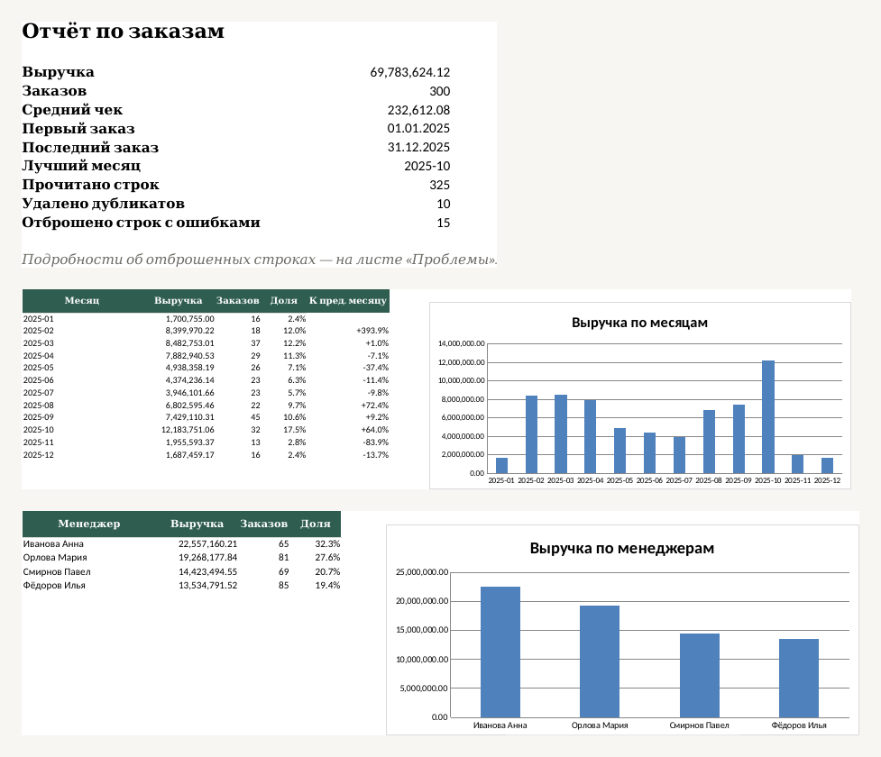

# excel-report-automation

*[Русская версия](README.md)*

Turns a messy export of orders (CSV or Excel) into a finished **Excel report** in one command: summary, monthly trend, managers, categories, top clients, charts. Every total in the report is a **live formula** (`SUMIFS`, `COUNTIFS`): edit a number on the "Данные" sheet and everything recalculates. The report text and column names are in Russian.

It targets the classic "someone rebuilds the weekly report by hand from a 1C or CRM export" job. The tool:

- understands mixed date formats (`05.03.2025`, `2025-03-05`, `05/03/25`) and number formats (`1 234,50`, `1,234.50`, `2 500 ₽`, `3 шт`);
- reads CSV in UTF-8 and cp1251 with `;`, `,` or tab delimiters, and `.xlsx` files; columns are recognised by synonyms (`Заказ` / `Номер заказа`, `Кол-во` / `Количество`, …);
- removes exact duplicates, rejects broken rows (impossible date, negative quantity, empty client, a price of "negotiable") and **explains each one** on the "Проблемы" sheet with its row number in the source file;
- merges spellings of the same client or manager: `ООО Лидер`, `ооо лидер` and `  ООО   Лидер ` become one company.



## Quick start

Python 3.10+ (tested on 3.13) and `openpyxl`.

```bash
git clone https://github.com/EminChyldyrly/excel-report-automation
cd excel-report-automation
pip install -r requirements.txt

python -m xlreport demo -o orders.csv          # a sample messy export of 500 orders
python -m xlreport build orders.csv -o report.xlsx --title "Orders 2025"
```

Result on the bundled example (`docs/example_orders.csv` → `docs/example_report.xlsx`):

```
Прочитано строк: 325        (rows read)
В отчёте заказов: 300       (orders in the report)
Удалено дубликатов: 10      (duplicates removed)
Отброшено строк с ошибками: 15
```

Both files are in `docs/`: [input](docs/example_orders.csv) and [output](docs/example_report.xlsx). The data is invented by the generator; no real clients are in it.

## Input

Seven columns in any order (extras are ignored): order number, date, client, manager, category, quantity, unit price. Amount = quantity × price.

Report sheets: **Сводка** (summary), **По месяцам** (every month in the range, empty ones included, with change versus the previous month), **По менеджерам**, **По категориям**, **Топ клиентов** (top 10), **Данные** (the cleaned table with a filter), **Проблемы** (issues). Each sheet fits the page width when printed.

## Use from Python

```python
from xlreport import read_table, clean_rows, build_report

result = clean_rows(read_table("orders.csv"))
print(len(result.orders), result.duplicates, result.rejected)
build_report(result, "report.xlsx", title="Report")
```

## How it is verified

27 tests (`python -m unittest discover -s tests`, about 3 seconds, `openpyxl` is the only dependency; one test needs LibreOffice and is skipped without it).

- **Cleaning is checked against the generator's ground truth.** The generator corrupts data in known ways and remembers the original orders. The test requires exactly those orders after cleaning, and the counts of removed duplicates and rejected rows to match what the generator injected.
- **Formulas are checked by recalculation.** The test builds a report, recalculates it in LibreOffice and compares revenue, average order, months, managers, top clients and shares with sums computed separately in Python.
- Also covered: day-first dates (`03.04.2025` is 3 April), year limits, a duplicate that differs only by case, one order number with different data, missing months, an empty export, cp1251, and xlsx input with real dates.
- I injected 20 typical bugs into the code (a flipped condition, a stray sign, a wrong sort order and so on). The tests caught 16 at once and missed three, for which new checks were added (year limits, manager order, month-over-month change). One mutation turned out to be equivalent to the original code.

## Limitations

- Formulas were recalculated only in LibreOffice; I did not open the file in Microsoft Excel. It uses standard `SUMIFS`, `COUNTIFS`, `INDEX`, `MATCH` and `IF`, so there should be no problems, but this is unverified.
- Dates are read day first: `03/04/2025` is always 3 April. US order is not supported.
- `1.234` is read as 1.234 (decimal point), not one thousand two hundred thirty-four.
- Money is computed in `float` and shown with two decimals; accounting-grade precision at very large volumes would need `Decimal`.
- From `.xlsx` only the first sheet is read, with headers in the first row.
- The column set is fixed (the seven fields above); another structure needs changes.
- Charts are plain bar charts and the styling is minimal.

## Structure

```
xlreport/
  clean.py    CSV/XLSX reading, date and number parsing, cleaning, duplicates
  report.py   Excel report builder (openpyxl)
  demo.py     messy-export generator with known ground truth
  cli.py      demo and build commands
tests/        unittest
docs/         sample input, sample report, README image
```

## License

MIT, see [LICENSE](LICENSE).
