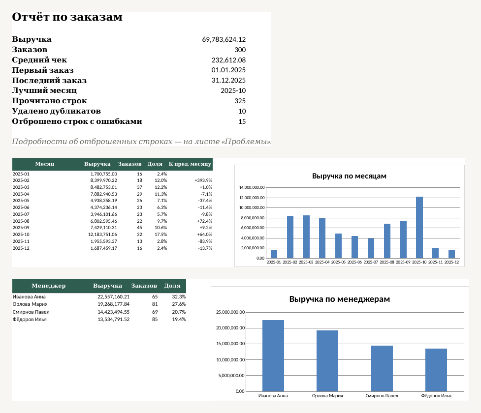

# excel-report-automation

*[English version](README.en.md)*

Из «грязной» выгрузки заказов (CSV или Excel) за один запуск собирает готовый **Excel-отчёт**: сводка, динамика по месяцам, менеджеры, категории, топ клиентов, графики. Все суммы в отчёте — **живые формулы** (`SUMIFS`, `COUNTIFS`): поправили цифру на листе «Данные», и всё пересчиталось.

Это типичная задача «есть выгрузка из 1С или CRM, каждую неделю руками собирают отчёт». Инструмент:

- понимает разные форматы дат (`05.03.2025`, `2025-03-05`, `05/03/25`) и чисел (`1 234,50`, `1,234.50`, `2 500 ₽`, `3 шт`);
- читает CSV в UTF-8 и cp1251, разделитель `;` `,` или табуляция, и файлы `.xlsx`; заголовки колонок распознаёт по синонимам (`Заказ`/`Номер заказа`, `Кол-во`/`Количество`, `Покупатель`/`Клиент`…);
- убирает точные дубликаты, отбрасывает битые строки (несуществующая дата, отрицательное количество, пустой клиент, цена «договорная») и **объясняет каждую** на листе «Проблемы», с номером строки в исходном файле;
- склеивает написания одного и того же клиента или менеджера: `ООО Лидер`, `ооо лидер` и `  ООО   Лидер ` — одна компания.



## Быстрый старт

Нужен Python 3.10+ (проверено на 3.13) и `openpyxl`.

```bash
git clone https://github.com/EminChyldyrly/excel-report-automation
cd excel-report-automation
pip install -r requirements.txt

python -m xlreport demo -o orders.csv          # пример «грязной» выгрузки на 500 заказов
python -m xlreport build orders.csv -o report.xlsx --title "Заказы за 2025 год"
```

Результат работы на примере (`docs/example_orders.csv` → `docs/example_report.xlsx`):

```
Прочитано строк: 325
В отчёте заказов: 300
Удалено дубликатов: 10
Отброшено строк с ошибками: 15 (см. лист «Проблемы»)
```

Готовые файлы: [docs/example_orders.csv](docs/example_orders.csv) (вход) и [docs/example_report.xlsx](docs/example_report.xlsx) (выход). Данные придуманы генератором, реальных клиентов в них нет.

## Что должно быть во входном файле

Семь колонок (порядок любой, лишние колонки игнорируются): номер заказа, дата, клиент, менеджер, категория, количество, цена за единицу. Сумма считается как количество × цена.

Листы отчёта: **Сводка**, **По месяцам** (все месяцы подряд, пустые тоже, с динамикой к предыдущему), **По менеджерам**, **По категориям**, **Топ клиентов** (10), **Данные** (очищенная таблица с фильтром), **Проблемы**. При печати каждый лист помещается по ширине страницы.

## Использование из Python

```python
from xlreport import read_table, clean_rows, build_report

result = clean_rows(read_table("orders.csv"))
print(len(result.orders), result.duplicates, result.rejected)
build_report(result, "report.xlsx", title="Отчёт")
```

## Как это проверено

27 тестов (`python -m unittest discover -s tests`, около 3 секунд, зависимость только `openpyxl`; для одного теста нужен LibreOffice, без него он пропускается).

- **Очистка проверяется по «правде» генератора.** Генератор портит данные известным способом и помнит исходные заказы. Тест требует, чтобы после очистки получились ровно они, а число удалённых дубликатов и отброшенных строк совпало с тем, сколько генератор подмешал.
- **Формулы проверяются пересчётом.** Тест собирает отчёт, пересчитывает его в LibreOffice и сверяет выручку, средний чек, месяцы, менеджеров, топ клиентов и долю с суммами, посчитанными отдельно в Python.
- Отдельно разобраны: дата с днём впереди (`03.04.2025` — это 3 апреля), границы года, дубликат с другим регистром, одинаковый номер с разными данными, пропущенные месяцы, пустая выгрузка, cp1251, xlsx с настоящими датами.
- Я внёс в код 20 типичных ошибок (перевёрнутое условие, лишний знак, неверный порядок сортировки и т. п.). 16 тесты поймали сразу, ещё три пропустили, и под них добавлены новые проверки (границы года, порядок менеджеров, динамика по месяцам). Одна правка оказалась эквивалентной исходному коду.

## Ограничения

- Формулы пересчитывались только в LibreOffice; в самом Microsoft Excel файл я не открывал. Используются стандартные `SUMIFS`, `COUNTIFS`, `INDEX`, `MATCH`, `IF`, так что проблем быть не должно, но это не проверено.
- Дата читается как «день.месяц»: `03/04/2025` всегда 3 апреля. Американский порядок не поддерживается.
- Число `1.234` читается как 1,234 (десятичная точка), а не как тысяча двести тридцать четыре.
- Деньги считаются в `float` и показываются с двумя знаками; для бухгалтерской точности до копейки при очень больших объёмах нужен `Decimal`.
- Из `.xlsx` читается только первый лист, из первой строки берутся заголовки.
- Набор колонок фиксирован (семь полей выше). Для другой структуры нужна доработка.
- Графики столбчатые, стандартные; оформление листов минимальное.

## Структура

```
xlreport/
  clean.py    чтение CSV/XLSX, разбор дат и чисел, очистка, дубликаты
  report.py   сборка Excel-отчёта (openpyxl)
  demo.py     генератор «грязной» выгрузки с известной правдой
  cli.py      команды demo и build
tests/        unittest
docs/         пример входа, пример отчёта, картинка для README
```

## Лицензия

MIT, см. [LICENSE](LICENSE).
